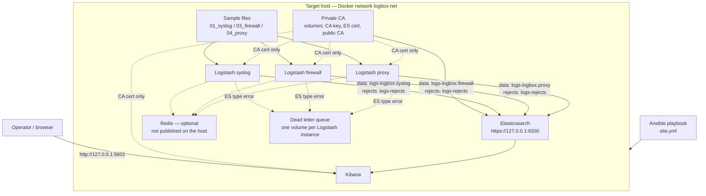
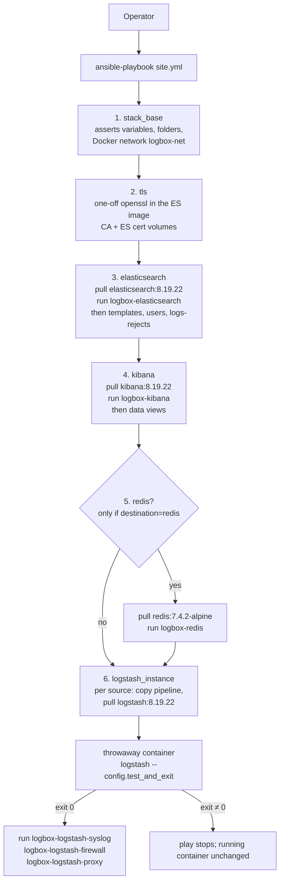

# Functional specification: Log Ingestion In A Box


## 1. Introduction

Three private sample logs (syslog, a CEF firewall log, a proxy CSV export) are read by one **Logstash** container per
source, normalised to **ECS 8** with `@timestamp` in UTC, and indexed into **Elasticsearch** with a deterministic document
id. Anything that does not fit ECS is kept under `org.metadata.*` (`org` is the default; the name is configurable via `metadata_namespace`). A record that cannot be parsed is not lost and does not stop
the run: it goes to a `logs-rejects` index with the reason and the place it came from. **Kibana** is the viewer. One **Ansible**
playbook provisions all of it as Docker containers. A functional test and a demo script prove and show it.

### 1.1 Architecture

One Ansible playbook on the controller creates everything on one Docker host. Solid arrows are the default path (Elasticsearch). The dashed
arrow is the optional Redis route (`destination: redis`). Ports on the host are bound to `127.0.0.1` only.



Each Logstash instance has its own `10-input` and `30-parse-and-map` files plus a copy of the **shared** filters (redact, sequence, id, reject
router, output). The three data indices and `logs-rejects` are what Kibana's Logbox views read. Redis, if used, gets the same JSON events
instead of Elasticsearch (either/or per source, not both).

## 2. What you need (requirements to run it)

Treat this as **two machines**. The **controller** is the computer that has Ansible and runs `ansible-playbook`. The **target** is a different computer that has Docker and runs every container (Elasticsearch, Kibana, one Logstash per source, Redis if used). The playbook copies configuration and sample files from the controller to the target; it does not install Docker or Ansible.

Today's demo inventory uses `ansible_connection: local`, so both roles sit on one WSL machine. That is a convenience, not the intended split. To use two machines, put the target in `ansible/inventory/hosts.yml` with `ansible_host` and `ansible_user` (see 6.3).

### 2.1 Controller (the machine that runs the playbook)

Nothing below is installed on the target by Ansible. Elasticsearch, Logstash and Kibana are **not** installed here.

| Need | Detail | Status |
|---|---|---|
| This repository | A checkout of the playbook, roles, Logstash config and templates. | Required |
| Ansible | `ansible-core` 2.20 or newer (tested with 2.20.1). | Required |
| `community.docker` collection | `ansible-galaxy collection install -r ansible/requirements.yml` (tested with 5.0.4). No Python Docker SDK is needed on the controller. | Required |
| Reachability of the target | SSH (or another Ansible connection) as a user who is allowed to run `docker` on the target. | Required |
| Sample files | The three private files in one folder on the **controller** (default `samples/`, or `-e samples_src_dir=...`). They are never in Git. The playbook copies them to the target. | Required |
| Secrets | **This demo:** `ansible/setup-secrets.sh` creates an encrypted Ansible Vault file (`group_vars/all/vault.yml`) with four random passwords (the Redis one is used only for the Redis route) and a local passphrase file `ansible/vault-password.txt` (mode 0600, gitignored) that Ansible reads to unlock it. **Production:** secrets are stored in the organisation's PAM (see §9.3). | Built (demo); production not built |
| Python 3 | Only if you run the test (`tests/functional_test.py`) or the demo script (`demo/demo.py`) from this machine; standard library only. Those scripts today also expect a local Docker CLI, which matches the one-machine demo. | Optional |

### 2.2 Target (the machine that runs the containers)

This host does **not** need Ansible, Elastic packages, or a browser. The playbook pulls official images and starts the stack.

| Need | Detail | Status |
|---|---|---|
| Docker Engine | Installed, running, and usable by the Ansible connecting user. Tested with Docker Engine 29.9.2 inside WSL2 (kernel 6.18). The playbook does **not** install Docker. Constraint C4 is Docker only (no Podman path). | Required |
| Python 3 | Ansible modules run on the target; it needs a Python 3 interpreter (`interpreter_python = auto_silent`). It does not need the Python Docker SDK. | Required |
| Elasticsearch, Logstash, Kibana | **Not installed as host packages.** The playbook pulls the official images `docker.elastic.co/{elasticsearch,logstash,kibana}:8.19.22` (one pinned version in `ansible/group_vars/all/main.yml`) and starts the containers. The target needs internet access to that registry, or a mirror that already has those images. | Required; provisioned by the playbook |
| **TLS certificates** | Nothing to pre-install: the playbook creates a private CA and Elasticsearch's certificate with `openssl` from the Elasticsearch image. TLS is on by default; `-e es_tls=false` for plain http. | Provisioned by the playbook |
| **Redis** | Only if a source uses `destination: redis`; the playbook deploys it. Not needed for the default Elasticsearch route. | Optional |
| Sample files on disk | Arrive as a copy from the controller; you do not place them on the target by hand. | Provisioned by the playbook |

Kibana is bound to `127.0.0.1:5601` **on the target**. Open it from a browser on that host, or through an SSH tunnel from the controller (on Windows with the one-machine WSL2 demo: `http://localhost:5601`, which WSL forwards).

## 3. Analysis of the three input files

### 3.1 What is in them

| Sample | Size | Shapes that complicate mapping |
|---|---|---|
| `01_syslog_unstructured.log` | 245 lines = 230 records | Two header formats in one file: RFC3164 (211 records, `Oct 14 00:02:17 host prog[pid]: text`, **no year, no time zone**) and RFC5424 (19 records, ISO time with `Z`, priority, structured data). Free-text bodies from ten programs (sshd, sudo, cron, nginx, postfix, ufw, application, tomcat, systemd, rsyslogd). 3 Java stack traces of 6 lines each that must be joined into one record. The same host written short and long (`mail01`, `mail01.example.edu`). Non-ASCII user names and text. Escaped quotes and brackets inside structured data. |
| `03_firewall_cef.log` | 240 lines | Every line is valid CEF (Common Event Format, a standard one-line security-event format) with a syslog prefix, for example `Oct 14 00:04:54 fw-edge01 CEF:0|ExampleSec|EdgeGuard NGFW|4.2.1|VPN-LOGIN|...|2|rt=... src=...`. `CEF:0` is the format marker (`0` = CEF version); then six `|`-separated header fields (vendor, product, version, signature, name, severity); then `key=value` pairs. What complicates mapping: **two time formats** in `rt` (epoch milliseconds 212, `Mon DD YYYY HH:MM:SS` with no zone 28); CEF escapes (`\=`, `\\`, `\|`, `\n`, `\r`), including a trap (`C:\\Users\\nguyễn.an` is a backslash then `n`, not a line break); custom fields as label/value pairs (`cs1Label=Rule cs1=...`) whose meaning is in the label; severity sometimes a word (`High`); values with spaces, quotes and pipes. |
| `04_proxy_export.csv` | 268 lines = 225 records | Header row. Quoted cells with commas and doubled quotes. **21 records whose `notes` cell contains line breaks**, so lines are not records. Trailing spaces, emoji and CJK text. `-` used for "no referrer". `bytes_sent` with no stated direction. Time already UTC with `Z`. |

### 3.2 Fields with no ECS equivalent, and what we did

Rule applied everywhere (R4): a value with no ECS home is kept **as written** under `org.metadata.<source>.*`. The name `org` is the default of the Ansible variable `metadata_namespace`, so the real location is `<namespace>.metadata.<source>.*` (set once, for example `-e metadata_namespace=acme`; this document writes `org` throughout). Nothing is dropped
and nothing is guessed into an ECS field. The raw record is always in `event.original`. This is what is actually stored today
(counted from the indexed documents):

| Source | Kept under `org.metadata.<source>` | Why there |
|---|---|---|
| Syslog | `timestamp` (the original RFC3164 time text), `sd_id` (RFC5424 structured-data id) | ECS has no field for the original time text or for the SD id. |
| Firewall | `rt` (original time text), `syslog_timestamp`, `syslog_host`, `cef_version`, `severity` (as written, number or word), `cat` (the vendor's category text, for example "Newly Registered Domain"), `cs1`, `cs2`, `cs3` and their `Label` keys, `fileHash` | `rt` is the original CEF receipt-time text; `@timestamp` holds the converted UTC value, and ECS has no leftover field for the original. `syslog_timestamp` is the syslog header time, which is only transport time (no year) and is not used as the event time (see 3.4). CEF version and `syslog_host` are likewise envelope details. `cat` is free text; ECS `event.category` only accepts a fixed vocabulary. ECS `event.severity` must be a number, and the word `High` has no agreed number. |
| Proxy | `event_time` (original time text), `bytes_sent`, `category` (the proxy's URL category), `notes` (free text, sometimes multi-line); plus `column14` if a row has an extra cell | `event_time` is the original CSV time text; `@timestamp` holds the converted UTC value, and ECS has no leftover field for the original (same reason as firewall `rt` and syslog `timestamp`). No ECS field for a proxy URL category or free-text notes. `bytes_sent` could be `http.request.bytes` or `http.response.bytes`; the file does not say which, and we do not assume (owner decision). |

Two more fields are produced by the pipeline itself, not by a log, and sit under `org.metadata.pipeline`:
`host` (inventory name of the machine that ran the pipeline) and `timestamp_basis` (see 3.4).

**What we do not guess into an ECS field** (REQ-2, R4, owner: "so we don't assume anything"). A value is mapped to ECS only
when the source names it clearly. We do not derive extra ECS fields from free text, from a lookup table, or by splitting a
value we already stored. Those values stay under `org.metadata.*`, in `message`, or in the ECS field already filled, so nothing
is dropped:

| Source | Not assigned to a further ECS field | Why (would be an assumption) | Where the value is |
|---|---|---|---|
| Syslog | Login user, outcome, source IP, command line, stack traces and other body details | The body is free text; reading `user.name` from "Failed password for X" would guess that the word after "for" is the account | `message` (searchable) and `event.original` |
| Firewall | `event.category` / `event.type` from the signature id; `rule.name` from `cs1`; `source.geo` from `cs3`; `file.hash.sha256` from `fileHash`; `event.severity` from the CEF severity | Category and type need a vocabulary table; `cs3` is free-text geo; severity is sometimes the word `High`; `fileHash` is kept as written rather than assumed to be SHA-256 | `org.metadata.firewall.*` |
| Proxy | `url.scheme`, `url.domain`, `url.path`, `url.query`; constant `event.category` / `event.type` | The whole URL is already in `url.original`; splitting it or labelling the event "web" would add meaning the file does not state | `url.original` |

What **is** mapped to ECS (the core): `@timestamp`, `event.original`, `event.dataset`, `event.created`, `event.id` (proxy),
`event.code` and `event.action` (firewall), `event.reason`, `host.name`, `process.name`, `process.pid`, `log.syslog.*` (from the
RFC5424/3164 priority), `observer.*`, `source.*`/`destination.*` (addresses, ports, bytes), `network.transport`, `client.ip`,
`user.name`, `user.full_name`, `user_agent.original`, `url.original`, `file.name`/`file.path` (firewall), `http.request.method`,
`http.request.referrer`, `http.response.status_code`, and the collector fields (`agent.name`, `log.file.path`, `related.*`).

### 3.3 Mappings that rest on an assumption

These mappings exist because REQ-2 says to map fields to ECS wherever possible: the source already names the value (a syslog header host, a labelled CEF key such as `suser` or `dvchost`, a CSV column such as `client_ip`), and ECS has a field built for that kind of value. The assumption is only **which** ECS field that named value belongs in, not a meaning invented from free text (those stay under `org.metadata.*` or in `message`; see 3.2). Each is a judgement the owner approved or can overrule. None is hidden: the original text is kept.

| Mapping | Assumption | How it is kept visible or safe |
|---|---|---|
| Syslog header host to `host.name` | The host in the line is the machine that produced the event, not the machine that collected it. | The collector is a separate field (`org.metadata.pipeline.host`, `agent.name`). By default the file input sets `host.name` to the Logstash/container host; `20-capture.conf` removes that `host` object. Firewall and proxy parse never set `host.name`, so leaving the input value would keep the container host on those documents and look like origin (R18). Short and long host names are **not** merged (no assumption that `mail01` equals `mail01.example.edu`). |
| RFC5424 structured-data `user="..."` to `user.name` | The structured-data parameter named `user` is the account. | The original stays in `log.syslog.structured_data`. |
| CEF `suser` to `user.name` and a copy in `source.user.name` | CEF calls `suser` the source user; `user.name` is also filled so one search works across sources. | Both fields are real ECS fields; the original key is not kept separately because the value is identical. |
| CEF `dvchost` to `observer.hostname`, not `host.name` | The line is about the device that logged it, not a host that produced it. | R18 requires origin ids never be masked or dropped. |
| CEF `in` / `out` to `source.bytes` / `destination.bytes` | The numbers are bytes in each direction as seen by the device. | Original `in`/`out` text is in `event.original`. |
| CEF `act` to `event.action` | Taken exactly as written; no translation to ECS vocabulary. | The ECS category and type classification by signature id (a table of six rows, the one place we would have assigned meaning) is **not built**. |
| Proxy `username` to `user.name`, `client_ip` to `client.ip` | The proxy's client is a `client`, not a `source`. | `client.ip` is an ECS field built for exactly this. |
| Proxy `event_id` to `event.id` | It is unique per record, so it can also be the document id. | A duplicate id in one file would overwrite (documented, section 4.3). |
| Proxy CSV `referrer` value `-` not stored as `http.request.referrer` | Means "no referrer": the field is removed, not stored as `-`. | Documented decision; `event.original` keeps the dash. |
| **Not assumed:** HTTP `status_code` not to `event.outcome`; proxy `bytes_sent` not to `http.request.bytes` or `http.response.bytes`; syslog login text not to `event.outcome` | Deliberately not derived (owner: "so we don't assume anything"). | The status code and the message text are searchable as they are. |

Login user and login id from free-text bodies (for example `Failed password for invalid user X`, `uid=...`) are not mapped:
that would guess that the word after "for" is the account. The text stays in `message` and `event.original`.

### 3.4 Time: what the files contain and how it becomes UTC

| Source and form | Count | Zone in the data | Year in the data |
|---|---|---|---|
| Proxy `event_time` | 225 | `Z` | yes |
| Syslog RFC5424 | 19 | `Z` (or an offset) | yes |
| Syslog RFC3164 | 211 | **none** | **no** |
| CEF `rt`, epoch ms | 212 | UTC by definition | yes |
| CEF `rt`, text | 28 | **none** | yes |

Rules (R3, R22), all **Built** and checked on every document by the test (`@timestamp` ends with `Z`):

1. **One time per event: the time the source itself reports.** For CEF that is `rt` (the device's receipt time), not the syslog
   header time, which is only transport time and has no year. The header time is kept under `org.metadata.firewall.syslog_timestamp`.
2. **Conversion** is done by Logstash's `date` filter, which stores `@timestamp` internally in UTC; Elasticsearch returns it as ISO-8601
   with `Z`. Epoch milliseconds are converted exactly (`UNIX_MS`, no zone needed). Times with their own zone (`Z`, an offset) keep it
   and are converted. Times without a zone are read in the **zone the operator declares**, per source, in the `log_sources` entry:
   `source_timezone` (default `UTC`).
3. **A missing year** (RFC3164 only) comes from `assumed_year`, per source, set by the operator. It is **required and has no default**:
   the playbook stops with a clear message if it is missing. A default of "the current year" would silently date old logs wrongly.
   The year is put in front of the text (`2026 Oct 14 00:02:17`) so the `date` filter parses a complete value. Two patterns handle
   syslog's padded one-digit day (`Oct  4`).
4. **The assumption is recorded on the event.** `org.metadata.pipeline.timestamp_basis` is `source-zone` (the time carried its own zone),
   `assumed-zone` (zone assumed) or `assumed-zone-and-year`. `event.timezone` holds the assumed zone only on those events. One filter
   finds every assumed time: `org.metadata.pipeline.timestamp_basis : "assumed-zone-and-year"`. In the samples: 211 syslog events carry
   `assumed-zone-and-year`; the other 19 syslog and all firewall epoch and proxy events carry `source-zone`.
   **Who writes it:** our own source filters, not Logstash and not Elasticsearch; nothing in the stack adds it by default. Each source's
   `30-parse-and-map.conf` sets it with a `mutate` step in the branch that decides how the time was obtained (syslog: `assumed-zone-and-year`;
   firewall: `assumed-zone`; proxy: `source-zone`). The inputs are the operator's Ansible variables `assumed_year` and `source_timezone`,
   passed to Logstash as `ASSUMED_YEAR` and `SOURCE_TIMEZONE`. The label is therefore a deliberate record of an assumption (R22), and it
   is the only place that says whether a time was stated by the source or supplied by the operator.
5. **Original text kept.** `event.original` and the leftover time text under `org.metadata.<source>`.
6. **Never the ingest time.** A time that is missing or cannot be parsed makes the record a reject (stage `<source>.date.timestamp`, error
   `invalid_time`). `event.created` holds the ingest time separately. A wrong time in a security log is worse than a visible reject.
7. **Evidence, not rule:** in these samples the zone-less times match the syslog header time of the same CEF lines, so UTC and 2026 are
   right for them. That is why zone and year are variables and not constants.

Known limits (design consequences, **not tested**): one `assumed_year` per source means a file that spans New Year would be dated wrongly on one
side of it; the remedy is one source entry per year. With a named zone (not UTC), local times that repeat or do not exist at a daylight-saving change
are resolved by the library, not flagged.

### 3.5 Complex but valid input: what we did

The samples hold no record that fails to parse (0 rejects). The difficulty is input that is valid but complex. Each case needed a
deliberate decision, made in the source's own input or filter file (nothing is left to a Logstash default):

| Case in the samples | Decision | Where it lives | Shown by |
|---|---|---|---|
| **Java stack traces in syslog** (245 lines = 230 records; 3 traces) | A line starts a new record only if it begins with an RFC3164 time (`Oct 14 00:02:17 `) or an RFC5424 priority (`<86>1 `). Every other line is glued to the previous record, so a trace stays with its `tomcat9` line as one event with its line breaks in `message`. The codec holds the last record back, so it is flushed after 2 seconds. The trace is not parsed into `error.stack_trace` (message bodies are not parsed in the demo build). | `sources/syslog/10-input.conf` (`multiline` codec) | Test: the 3 traces are 3 documents tagged `multiline` with line breaks in `message`; record count 230 |
| **Proxy `notes` cells with line breaks** (21 records, 268 lines = 225 records) | Same idea, with a different start rule: a record starts at the header row or at a line beginning with a UTC time and a comma. The other lines belong to the previous record. The `csv` filter then undoes standard CSV quoting (commas, `""` and line breaks inside quotes). There is no backslash unescaping in CSV, so `C:\Users` and `\n` stay as typed. A bad row whose first cell is not a UTC time would be glued onto the previous record; the filter detects a line break outside quotes and rejects it (`proxy.csv.record`, `malformed_record`) instead of silently losing it. | `sources/proxy/10-input.conf`, `30-parse-and-map.conf` | R16 test: 21 multi-line notes arrive as 21 single documents with the line breaks intact; broken-row fixture |
| **CEF escapes** (`\=`, `\\`, `\|`, `\n`, `\r`) | Splitting into key=value happens first, so an escaped `=` never starts a new key. After the split, a Ruby step undoes the escapes using a fixed table: in the header `\|` and `\\`; in values `\n`, `\r`, `\=`, `\\`. An unknown escape (for example `\s`) is left exactly as written. It covers every key under `org.metadata.firewall`, including keys not seen before. The trap is a Windows path whose backslashes are doubled in the file: the raw line has `filePath=C:\\Users\\nguyễn.an\\Downloads\\résumé_final.docm`; the stored `file.path` is `C:\Users\nguyễn.an\Downloads\résumé_final.docm` (single backslashes; checked in the index: 28 paths starting `C:`, none with a doubled backslash). `event.original` keeps the raw text. If the Ruby step fails, the event is rejected, never indexed half-converted. | `sources/firewall/30-parse-and-map.conf` (`firewall.ruby.unescape`) | Firewall fixtures; counts 240 of 240 |
| **Several time formats, some with no year or zone** | The source's own time is used, converted to UTC by the `date` filter. Zone or year that the file lacks come from the operator (`source_timezone`, `assumed_year`), are marked on the event, and are never defaulted silently. A time that cannot be parsed is rejected, never replaced by the ingest time. | `30-parse-and-map.conf` per source, `ansible/group_vars/all/log_sources.yml` | §3.4; every `@timestamp` ends in `Z` |
| **"Failed password for …" and "invalid token"** (text that looks like a credential but is not) | Only a credential key followed by `=` or `:` is masked (`password=`, `token=`, `secret:`, `Authorization: Bearer …`). The words alone have no `=` or `:` after them, so they pass through unchanged. The key stays; the value becomes `[REDACTED]`. A key inside a longer word (`xtoken=`, `session_token=`) is not matched. | `shared/22-redact.conf` (on the raw record, before parsing) | Redaction fixtures: values masked, "Failed password for admin" untouched; no credential value in any field except `event.original` |

The mapping of the resulting fields is in 3.2 and 3.3; the redaction rule and its limits are in section 9.

## 4. Record identity: numbering and document ids

### 4.1 What is generated and with what

Three kinds of name appear in the pipeline. They are not interchangeable:

| Kind | Where it lives | Indexed? | Examples |
|---|---|---|---|
| **ECS** | Elastic Common Schema on the document | Yes | `event.original`, `event.created`, `event.id`, `event.kind`, `agent.name`, `host.name`, `related.ip`, `error.type`, `message` |
| **Metadata** (`org.metadata.*`, or `<namespace>.metadata.*`) | Our leftovers and pipeline bookkeeping on the document | Yes | `org.metadata.firewall.cat`, `org.metadata.pipeline.host`, `org.metadata.reject.stage` |
| **Logstash-internal** | `@metadata.*` (dropped at output), tags such as `_reject`, and **filter ids** (`id =>` on a plugin: the name Logstash logs, and the stage name if that plugin fails) | `@metadata` is not indexed. Filter ids live in logs, not as document fields | `[@metadata][occurrence]`, `[@metadata][doc_id]`, `[@metadata][assumed_year]`, `[@metadata][time_parsed]`, `[@metadata][route]`; filter id `common.docid.fingerprint` |
| **Elasticsearch `_id`** | Cluster document key (`GET index/_doc/<id>`), stored separately from `_source` | N/A | 64-hex digest from `[@metadata][doc_id]` |

| Item | Kind | Value | How it is produced |
|---|---|---|---|
| `[@metadata][occurrence]` | Logstash-internal | How many times this exact raw record was seen before in this run (0 for the first copy, 1 for the second). Dropped at output; only used to build `_id`. `common.occurrence` is the Logstash filter id on that Ruby plugin. | **Ruby filter** `25-occurrence.conf` |
| Document `_id` | Elasticsearch key, **not ECS** | 64-hex SHA-256. ECS's event identifier is `event.id` (we set that only for proxy, from the CSV `event_id` column). | **Built-in `fingerprint` filter** `60-doc-id.conf` (`common.docid.fingerprint` / `common.docid.fingerprint.event_id` are the Logstash filter ids on those plugins), then `document_id` on the Elasticsearch output. This **overrides** Elasticsearch's default, which would assign a new random `_id` to every write. |

There is **no `record_seq`**. Logstash has no record number (the file input can set a byte offset, `log.offset`). A 1-based counter would only match file order with `pipeline.workers: 1`, so it was not kept. Locate a record with `event.id` (proxy), `event.original` / `message`, or `log.file.path` plus `log.offset`.

Ruby is used in only two places in the whole pipeline, and not because it is generally easier:

1. **The occurrence filter** (`25-occurrence.conf`). It needs a table that persists from event to event, which no built-in filter keeps. The lock keeps the count right with more than one worker.
2. **The CEF unescape** (`firewall.ruby.unescape` in `sources/firewall/30-parse-and-map.conf`). Built-in `mutate`/`gsub` is the wrong tool here. CEF writes `\\` for a backslash, `\=` for `=`, `\n` for a line break and `\r` for a carriage return. A global replace of `\n` by a line break would also hit the trap path `C:\\Users\\nguyễn.an` (a backslash followed by the letter `n`, not a newline) and split the user name. The safe way is to walk the string left to right, one backslash plus the next character at a time, and look that pair up in a table. Ruby does that in one line. A plain-filter version needed about 170 generated lines, could only name fields in advance (so a CEF key we had never seen would keep its escapes), and could not produce a carriage return. If the Ruby step fails, the event is rejected and never indexed half-converted.

The document id itself is built with a standard filter (`fingerprint`), not Ruby.

The occurrence table lives in the filter object, which Logstash creates once at start. It starts empty again when the container restarts.

### 4.2 The id rule (R20)

R20: the document `_id` is **deterministic**. Elasticsearch's default is a new random id on every index request. We override that: `60-doc-id.conf` builds a hash, and `90-output.conf` sends it as `document_id` with `action => index`, so a second write of the same record **replaces** the first (`_version` goes up, the count stays the same).

That matters because Logstash delivers **at least once**, we re-read the whole file on every start (`sincedb` is `/dev/null`), and the playbook may restart a container. Without a fixed `_id`, each of those would **duplicate** every record. With it, a demo re-run, a crash recovery, or a retried batch is safe: 230 syslog records stay 230 documents.

`_id` is not ECS. Do not map it to `event.id`. `event.id` is the source's own id when it has one (proxy only).

How the hash is computed (`60-doc-id.conf` branches; the fingerprint plugin's `source` list is field paths on the event, so a year that lives only in an environment variable is copied onto the event first):

- **Proxy:** SHA-256 of **dataset + `event.id`** (the CSV `event_id` column).
- **Syslog:** SHA-256 of **dataset + raw record + occurrence + `assumed_year`**. RFC3164 lines have no year in the text, so the same line from two operator years would otherwise share an `_id`. This branch copies `ASSUMED_YEAR` onto `[@metadata][assumed_year]` and includes it. RFC5424 lines already have a year in `event.original`; they still use this branch so syslog has one hash recipe.
- **Firewall:** SHA-256 of **dataset + raw record + occurrence**. CEF `rt` already includes a year (epoch or text). There is no `assumed_year` on this source.
- The digest is plain SHA-256 of those fields (`method => SHA256` on the fingerprint plugin, no `key`).

### 4.3 Why a custom id instead of Elasticsearch's own

| | Elasticsearch auto-generated id | Our deterministic id |
|---|---|---|
| Re-reading a file (restart, replay, re-run) | New random ids: every record is **duplicated** | Same ids: the second read **overwrites**; counts unchanged (tested: document counts and ids identical, `_version` rises) |
| Retried or redelivered batch (Logstash delivers at least once) | May duplicate | Idempotent |
| Two genuinely identical lines in a file | Two documents | Still two documents, because of the occurrence number |
| Reconciliation and tracing | No link to the input | `_id`, `event.original`, `log.file.path` (and `event.id` for proxy); the test checks counts and ids |
| Cost | None | Known consequences below |

Known consequences of the **demo** id rule, and what a **future version** would change:

| Now (demo) | Why it is a problem | Future version |
|---|---|---|
| Two proxy rows with the same `event_id` in one file become **one** document (the later write wins) | The proxy id is `hash(dataset + event_id)` only. Elasticsearch stores one document per `_id`, so the second row overwrites the first. Those two rows can be two real events that reused an id. Syslog already avoids this by adding an occurrence number. | Include the occurrence number in the proxy id too (`hash(dataset + event_id + occurrence)`), so two rows stay two documents; or reject the later row as a duplicate instead of overwriting. |
| For syslog and firewall, `_id` is a SHA-256 hash of `event.original` (the **unredacted** raw line), plus dataset and occurrence (syslog also includes `assumed_year`). Elasticsearch stores only the 64-hex digest as `_id`, not the line. | Uniqueness is fine (the line plus occurrence is unique). The problem is **input to the hash**: `event.original` can contain a password. The digest cannot be turned back into the password, but we still hashed a secret. | Hash the **redacted** `message` (or named fields after redaction), so a secret never enters the hash. |
| A restart re-reads the **whole** file from the first byte. Each source's `10-input.conf` uses Logstash file input `mode => "read"` (read once, then treat the file as complete). The file input's memory of "how far I have read" is called a **sincedb**; we set it to `/dev/null`, which means "do not remember, always start at the top". | Matches a demo sample copied in by Ansible. A live log that grows is not ingested until the container is restarted. Wasteful for a large file: every restart copies every record again. | **Production:** `mode => "tail"` so new lines are ingested as they are appended, and a real sincedb file (byte offsets) so a restart continues from the last position. Retries still overwrite, because `_id` is unchanged. |

## 5. Flexibility and scale

### 5.1 How the design separates concerns (Built)

- **One Logstash container per source** (`log_sources` entry), each with its own copy of the configuration.
- Each source supplies exactly two files, `10-input.conf` and `30-parse-and-map.conf`; **shared files** do everything common to all sources
  (capture of the raw record and ingest time, redaction, occurrence, validation, ids, reject routing, collector fields, output). Shared files never name a source. Files are copied
  into one folder and run in filename order; there is no override between shared and source files.
- Adding a source: a new folder under `logstash/sources/<name>/` and one `log_sources` entry. No change to the shared files or the playbook.
- The destination is a single file, `90-output.conf`. The parsing stage does not know where the events go.

Logstash loads every `.conf` in the instance's pipeline folder **in filename order**. Ansible copies the shared files and the source's two files into that one folder, so a syslog instance runs `10` (syslog input), then `20`–`25` (shared), then `30` (syslog parse), then `50`–`90` (shared).

**Shared** (`logstash/shared/`) — copied into every instance. These files never name a source. Field kinds (see 4.1): **ECS**, **metadata** (`org.metadata.*`), **Logstash-internal** (`@metadata.*`, tags, filter ids).

| File | What it does |
|---|---|
| `20-capture.conf` | Captures the ECS event envelope before redaction and parse. **ECS:** `event.original`, `event.created`. Copies `@timestamp` (still the ingest clock) into `event.created` before the source `date` plugin overwrites it. Removes `@version` and `host`: by default the file input sets `host.name` to the Logstash/container host; firewall and proxy never set `host.name`, so that value would remain and look like the origin. Collector identity is `agent.name` and `org.metadata.pipeline.host`. |
| `22-redact.conf` | Masks credential `key=value` (and `Authorization: Bearer`) on **ECS** `message`. **ECS** `event.original` is already stored and stays unredacted. |
| `25-occurrence.conf` | Sets **Logstash-internal** `[@metadata][occurrence]` (0 the first time this raw line is seen, 1 the second, …). Dropped at output. `common.occurrence` is the Logstash filter id on the Ruby plugin. |
| `50-validate.conf` | Backstop so an event without a parsed timestamp cannot be treated as data. Depends on the source `date` plugin setting **Logstash-internal** `[@metadata][time_parsed]`. If that flag is missing and **Logstash-internal** tag `_reject` (ours, not ECS) is absent, it adds `_reject`, **ECS** `error.type` / `error.message`, and **metadata** `org.metadata.reject.stage` (value `common.validate.required_fields` is a stage name, not ECS). Does not write or drop. |
| `60-doc-id.conf` | `fingerprint` plugin writes **Logstash-internal** `[@metadata][doc_id]`. Filter ids `common.docid.fingerprint.event_id`, `common.docid.fingerprint.syslog`, and `common.docid.fingerprint` are labels in Logstash logs. Output uses `doc_id` as Elasticsearch `_id`. Proxy: hash of **ECS** `event.dataset` + `event.id`. Syslog: dataset + `event.original` + occurrence + `[@metadata][assumed_year]` (copied from `ASSUMED_YEAR`; RFC3164 has no year in the line). Firewall: dataset + `event.original` + occurrence (CEF `rt` already has a year). |
| `70-reject-router.conf` | Fills reject bookkeeping; does not write or drop. Reads **Logstash-internal** `_reject` and plugin tags (`_grokparsefailure`, …). Sets **Logstash-internal** `[@metadata][route]` (`rejects` or `data`). On reject: **ECS** `event.kind` = `pipeline_error`, `@timestamp` from **ECS** `event.created`; **metadata** `org.metadata.reject.stage` = `unknown` if missing. |
| `85-collector.conf` | Who collected the event, not who produced it. **ECS** `agent.name` = instance. **Metadata** `org.metadata.pipeline.host` = inventory hostname. Origin stays in **ECS** `host.name` or `observer.hostname`. |
| `87-related.conf` | Copies into **ECS** `related.*` (not metadata): `related.ip`, `related.user`, `related.hosts` (and `related.hash` if `file.hash.sha256` exists). |
| `88-namespace.conf` | Renames the **metadata** object `org` to `METADATA_NS` when that is not `org`. Does not classify fields. **Logstash-internal** `@metadata.*` is unchanged. |
| `90-output.conf` | Writes the event. Reads **Logstash-internal** `[@metadata][route]` and `[@metadata][doc_id]`. Data → `logs-<dataset>`; rejects → `logs-rejects`. `_id` is Elasticsearch, not ECS. |

**Syslog** (`logstash/sources/syslog/`)

| File | What it does |
|---|---|
| `10-input.conf` | Reads the file. A new record starts at an RFC3164 time or an RFC5424 priority; other lines (Java stack traces) join the previous record. |
| `30-parse-and-map.conf` | Parses RFC3164/5424 header. **ECS:** `@timestamp`, envelope fields, body in `message`. **Logstash-internal:** `[@metadata][time_parsed]` on date success; `_reject` on failure. **Metadata:** leftover time text under `org.metadata.syslog.*`. |

**Firewall** (`logstash/sources/firewall/`)

| File | What it does |
|---|---|
| `10-input.conf` | Reads the file; one CEF line is one record (no multiline). |
| `30-parse-and-map.conf` | Parses syslog prefix + CEF, undoes CEF escapes (Ruby). Named keys → **ECS**; leftovers → **metadata** `org.metadata.firewall.*`. **Logstash-internal:** `[@metadata][time_parsed]`, `_reject`. |

**Proxy** (`logstash/sources/proxy/`)

| File | What it does |
|---|---|
| `10-input.conf` | Reads the file. A new record starts at the CSV header or a UTC timestamp; other lines (notes with line breaks) join the previous record. |
| `30-parse-and-map.conf` | Parses CSV. **ECS:** `@timestamp` from `event_time`, mapped columns, `event.id` from `event_id`. **Metadata:** leftovers under `org.metadata.proxy.*`. **Logstash-internal:** `[@metadata][time_parsed]`, `_reject`. |

**Demo vs production file input.** All three `10-input.conf` files use `mode => "read"`: Logstash reads the sample **once** and does not watch for later appends. A new line appears in Kibana only after Ansible copies the file and restarts that container. **Production** would change this to `mode => "tail"` (and a real sincedb; see 4.3) so a growing firewall or syslog file is ingested as it is written.

### 5.2 Other destinations (Designed or Idea; none is built)

| Destination | Position | What it would take | Verified here |
|---|---|---|---|
| **Redis** | **Built 2026-11-02** (R7, stretch goal): either/or per source, no forwarder tier | One shared `90-output.conf` with a branch on the `DESTINATION` environment variable (no per-source output files); the `destination` setting per source or `default_destination` for a run; a `redis` Ansible role (below). Redis gets the same JSON events: list `logs-<dataset>` for data and `logs-rejects` for rejects | Run on the proxy sample: 225 records in `logs-logbox.proxy`, Elasticsearch untouched, second run `changed=0`, switch back restores Elasticsearch. Not part of the functional test |
| **Kafka or Redpanda** | Idea | A `kafka` output (Redpanda speaks the Kafka protocol). Consumers (for example a second Logstash with a `kafka` input, or a sink connector) index into Elasticsearch. Gives buffering and fan-out. Keep the `_id` in the message so the consumer stays idempotent | The `kafka` input and output plugins are present in the image. **Not built or tested.** |
| **AWS** | Idea | `s3` output for archive, `sqs` output for queues (both present in the image); Amazon OpenSearch Service needs the OpenSearch output plugin, which is **not** in the image and would be installed. Kinesis is likewise not bundled | Plugin list checked on the running image. **Not built or tested.** |

**How Redis routing is selected (Built)**

| Question | Answer |
|---|---|
| A Logstash configuration per type? | **No.** Parsing is per source (syslog, firewall, proxy); the destination is **one shared file**, `90-output.conf`. A new destination is a new branch in that one file, not a copy of every source |
| Parameter for the destination | `destination` in a source's `log_sources` entry (`elasticsearch` or `redis`), or for one run on the command line: `ansible-playbook site.yml -e default_destination=redis`. A source's own `destination` wins over `default_destination` |
| Default | **`elasticsearch`**. Nothing changes unless you set the parameter |
| Host and port | `redis_host` and `redis_port` (defaults: the container this playbook starts, `logbox-redis`, port 6379, so the demo needs nothing set). Pass them to Logstash as `REDIS_HOST` and `REDIS_PORT`. `redis_port` also sets the port the playbook's own Redis listens on |
| An existing Redis instead | `redis_external: true` with `redis_host` and `redis_port`: the playbook does **not** start Redis and Logstash sends to that address; the password is still `vault_redis_password`. Verified 2026-11-02 against a separate Redis container on port 6390 |
| What Ansible does differently | Deploys Redis (`logbox-redis`, pinned `redis:7.4.2-alpine`, password from the vault as `vault_redis_password`, append-only file on a volume, **not published** on a host port) only when an enabled source routes to it; passes `DESTINATION`, `REDIS_HOST`, `REDIS_PASSWORD` to each Logstash container; checks that the value is supported and that the password exists; the usual `--config.test_and_exit` runs with the same settings |
| What is sent | The same events, including rejects (`logs-rejects`); `@metadata` is not sent. One destination per source; no copy to both |
| Limits | Redis has no field types and no document id: the deterministic id (R20) does not apply, so a restart appends the records again; no consumer is provided (what reads the list is out of scope); **TLS to Redis is out of scope** (owner, 2026-11-02): the Redis route only demonstrates that Logstash can route to another destination. There is no technical obstacle (the Redis output plugin has `ssl_*` settings and the Redis image supports TLS); it would need a Redis certificate from the existing CA and the same switch, about an hour. Treat Redis as unencrypted, and an external Redis on another server as not production-ready; single Redis only (no Cluster or Sentinel); the Redis list is unbounded in memory/disk |

Because the parse stage is identical for every destination, only the output block and its credentials change.

### 5.3 Horizontal scale and placement (Built in principle; tested only on one host)

- Scaling out means **more instances for more sources**: another `log_sources` entry gives another container with the same shared logic.
- The playbook targets an **inventory host**, so an instance can run on a different machine, **close to the log source**: add a host in `ansible/inventory/hosts.yml`
  and run the playbook against it. Elasticsearch location is a variable (`es_url`, `es_internal_url`). Today all hosts in the demo are one machine; a second host
  has **not** been exercised.
- The deterministic id means two instances that happen to read the same record produce the same document, so overlap does not duplicate.

### 5.4 The limit: more capacity for the same source

There is **no mechanism to add more Logstash instances against one source file**. A Logstash `file` input has no coordination between instances, and our
demo uses `mode => "read"` with no read position (`sincedb_path` is `/dev/null`; a restart reads from the top). Two instances on the same file would both read all of it:
no extra throughput, no way to say which instance ingested which record. Throughput for one source today is therefore bounded by one pipeline
(raise `workers` on that instance for filter CPU; the file is still read on one thread; see 5.5).

**Idea (not decided): Filebeat in front of Logstash.**
- Filebeat keeps a **registry of read offsets per file**, so it knows what has been shipped and resumes after a restart. It can send to several Logstash
  instances (`loadbalance`), which gives real horizontal scaling of one source's ingest and moves file tracking out of Logstash.
- Delivery is at least once; our deterministic id already makes that safe.
- What would change: the file input and the multiline handling (proxy CSV and stack traces) move to Filebeat configuration; Logstash would use a `beats` input
  (present in the image); locate a record with `log.file.path` plus `log.offset` (or the source's `event.id`). Filebeat would run near the
  source, which fits the placement point in 5.3. This needs a design pass and tests before it is claimed.

### 5.5 Performance knobs on this architecture (Built)

These settings make **one existing instance** faster or larger. They do not add instances, change the file input, or require Filebeat. The demo files are small, so the defaults stay low. Set them in Ansible and re-run the playbook (the container restarts).

Per source, in that source's `log_sources` entry (`ansible/group_vars/all/log_sources.yml`):

| Setting | Logstash name | Default | What raising it does | Limit |
|---|---|---|---|---|
| `workers` | `pipeline.workers` | `1` | More filter threads (grok, date, Ruby unescape, fingerprint, mutate). Use this when CPU on that Logstash container is busy. | The **file is still read on one thread**, so this does not parallelise reading. The occurrence filter (`25-occurrence.conf`) uses a lock, so two identical lines still get two `_id`s with workers above 1. More workers need more heap. Logstash's own default is one worker per CPU, which would waste RAM on three demo containers. |
| `batch_size` | `pipeline.batch.size` | `125` | Each worker sends larger batches to Elasticsearch (fewer, heavier bulk requests). | Memory per batch grows. A retry after a short Elasticsearch blip resends the whole batch. |
| `batch_delay` | `pipeline.batch.delay` | `50` (milliseconds) | How long a worker waits for a partial batch to fill. **Lower** it for less wait at the end of a small file; **raise** it so batches fill on a slow trickle. | A large delay adds latency. The demo files finish in seconds either way. |
| `heap` | `LS_JAVA_OPTS` (`-Xms` / `-Xmx`) | `512m` | More JVM heap for that Logstash when workers or batches grow, or when grok/Ruby hold more events. | The container memory cap is **twice the heap plus 512 MB** (`512m` heap → `1536m` cap). Raise `heap`; do not set the cap by hand. |

Example (only the busy source):

```yaml
- name: proxy
  file: 04_proxy_export.csv
  workers: 4
  batch_size: 250
  heap: 1g
```

Whole-stack memory (`ansible/group_vars/all/main.yml`), if Elasticsearch or Kibana is the bottleneck rather than Logstash:

| Setting | Default | What raising it does | Limit |
|---|---|---|---|
| `elasticsearch_heap` | `512m` | More JVM heap for indexing and queries. | Keep `es_memory` (container cap, default `3g`) well above the heap. A cap that is too tight gets the container killed by the kernel. |
| `es_memory` | `3g` | Docker hard memory limit for Elasticsearch. | Must stay larger than `elasticsearch_heap` plus off-heap use (measured idle ~2 GB at the demo heap). |
| `kibana_memory` | `2g` | Docker hard memory limit for Kibana. | Kibana is not on the ingest path; raise it if the UI is slow, not to ingest faster. |

What these knobs **cannot** do: two Logstash containers on the **same** file (that is 5.4), or more read throughput than one `file` input thread. For that, the next step is still Filebeat in front (idea in 5.4). A discussion of many files, other backends, and a one-year SIEM archive is in section 12 (future improvements).

## 6. Provisioning with Ansible

### 6.1 What the playbook does (Built)

`ansible-playbook site.yml` runs these roles, in order, against the inventory host. Each role that needs an image **pulls it if missing** (`docker.elastic.co/...:8.19.22`, or `redis:7.4.2-alpine`) and then starts or updates the named container. Redis is skipped unless a source has `destination: redis`. Logstash is started only after a throwaway `--config.test_and_exit` container exits 0.



Images stay on the host after the first pull. A second playbook run does not recreate a container that is already correct (`changed=0`). Ports: Elasticsearch `127.0.0.1:9200`, Kibana `127.0.0.1:5601`; Logstash and Redis are not published.

`ansible/site.yml` roles:

| Role | Does |
|---|---|
| `stack_base` | Checks that TLS is not switched on (not implemented), every source entry is complete (syslog must have `assumed_year`), the TLS switch is valid, the three secrets exist in the vault (and the Redis one when Redis is used), every `destination` is supported, and each sample file exists on the controller; creates the working folders and the Docker network |
| `elasticsearch` | Runs the container (single node, security on); waits until healthy; installs the index templates; creates the empty `logs-rejects` index; creates the least-privilege Logstash role and user and the Kibana system password |
| `kibana` | Runs the container (published on `127.0.0.1`); waits until available; creates the five data views, the default view and the default Discover time window |
| `redis` | Only when an enabled source has `destination: redis`: runs `logbox-redis` (password from the vault, not published) and waits until it answers (section 5.2) |
| `tls` | Creates the private CA and Elasticsearch's certificate once (a one-off container using `openssl` from the Elasticsearch image) into three Docker volumes, and leaves the public CA certificate at `<base>/certs/ca.crt`; reissues the certificate only if `es_tls_dns`/`es_tls_ips` change. Runs in both modes (Logstash needs the CA file to exist) |
| `logstash_instance` | Per source: copies the shared and the source configuration into one folder, removes stale files, writes `logstash.yml`, copies the sample file to the host, **tests the configuration with `--config.test_and_exit`**, and only then runs the container; the container restarts only if something changed |

Variables of note: `log_sources` (per source: name, file, `assumed_year`, `source_timezone`, workers, heap), `enabled_sources` (choose sources per run, used by
the demo script), `extra_log_sources` (used by the test fixtures), `samples_src_dir`, `logbox_base_dir`, versions, ports, `kibana_bind`, `es_tls` (default true), `es_tls_dns`, `es_tls_ips`.

Idempotence (R14): every write is conditional (templates and roles carry a hash marker; users are written only if a login fails; views are compared). A second run
reports `changed=0` (tested). Because the `uri` module never reports "changed" by itself, the write tasks state it explicitly.

### 6.2 Where it provisions today

**Yes: today it provisions Docker containers (pulled from Elastic's registry) onto the Docker Engine inside WSL2 on Windows.** Ansible runs inside WSL and connects to
the host `demo-host` over a **local** connection; nothing runs natively on Windows. Kibana is reached from the Windows browser through WSL's port forwarding.

### 6.3 Moving to another host, for example Red Hat, Alma or Rocky 8+

The STACK lists Red Hat / Alma / Rocky 8+ (and Windows, macOS). The structure supports a remote host (an inventory host with an address and user, sample files copied from the controller, no `localhost` assumed in the tasks), so the work is
mostly **prerequisites and a few host-specific settings**, not a redesign. **None of this has been tried** (a Rocky/Alma VM run is a stretch).

| Item | Status |
|---|---|
| Inventory | Add a host with `ansible_host` and `ansible_user` (and `ansible_become` if needed) in `ansible/inventory/hosts.yml`. Small. |
| Docker Engine | The playbook assumes it is installed and running. RHEL-family distributions ship Podman, not Docker; the owner's constraint is Docker only, so Docker Engine must be installed from Docker's repository. A role that does this is **not written**. |
| SELinux | **Not a requirement of this solution.** It is not installed, enabled or configured by the playbook. It only matters if the host itself is enforcing (typical default on RHEL, Alma and Rocky 8+): then containers cannot read bind-mounted folders unless the mounts carry an SELinux label (`:z`). The Logstash pipeline, config and data mounts do not have it today, so **expect that case to fail until the mounts are labelled**. It does **not** apply on the current demo host (WSL2), nor on Alma/Rocky/RHEL if SELinux is permissive or disabled, nor on Windows or macOS. |
| Kernel setting | Elasticsearch normally wants `vm.max_map_count=262144`. The playbook does not set it (single-node mode relaxes the check, but a production host should have it). |
| Firewall | Ports are bound to `127.0.0.1`, so nothing to open; remote Kibana access is by SSH tunnel. |
| Sample files | Copied by the playbook from the controller. For a remote site the files normally already sit on the host near the source; there is no "path already on the target" option. |
| Controller | `ansible-core` 2.20 and the collection are needed only on the controller. |

## 7. Robustness

| Concern | Behaviour today |
|---|---|
| One bad record | Never stops the run; goes to `logs-rejects`; the next record continues (tested with a broken record per source) |
| Re-run, restart, replay | Safe: deterministic ids overwrite; the playbook and the test prove it (`changed=0`; document counts and ids unchanged) |
| Container crash or host reboot | `restart: unless-stopped`; the container re-reads its file from the top (safe, see 4.3) |
| Elasticsearch slow or down | Logstash's Elasticsearch output **retries** the batch (it waits and sends again) until Elasticsearch accepts it, or until the refusal is permanent (a type error goes to the dead letter queue). **Back pressure:** if retries pile up, the in-memory queue fills and Logstash pauses reading the file, so Elasticsearch is not flooded; when it recovers, the queue drains. This is built-in plugin behaviour, not our code. The playbook also starts Logstash only after Elasticsearch is healthy. Events still in memory are lost if the container is killed; a re-run restores them (deterministic ids). |
| Elasticsearch refuses a document (for example a type conflict) | Goes to the dead letter queue (64 MB cap, on its own volume; see 8.5). The test requires the DLQ to be empty for the real samples and proves the path with one record Elasticsearch must refuse |
| Configuration mistakes | Two gates, two owners. (1) **Ansible** asserts **its** variables before it changes anything (`stack_base`): vault secrets, sample file present, `destination` legal, syslog `assumed_year` set. `assumed_year` is an operator setting (RFC3164 has no year in the file; Ansible passes it as `ASSUMED_YEAR`). It is not Logstash parsing the log. There is no default year: a wrong default would silently date old logs and change document ids. Logstash still owns whether a given timestamp **parses**; that failure is a reject (`invalid_time`). (2) **Logstash** `--config.test_and_exit` in a throwaway container, before each real start (see 7.1): syntax errors and unknown plugin settings. No automatic config reload: a change is a deliberate restart. |
| Secrets in a fresh clone | Generated per clone, never committed |

### 7.1 Configuration test before start (`--config.test_and_exit`)

**What it does.** For every source, the `logstash_instance` role runs a short-lived container (`logbox-logstash-<name>-configtest`, same image, same pipeline folder, `logstash.yml` and environment, 256 MB heap)
with `--config.test_and_exit`, **before** the real container task. Logstash loads and compiles the whole pipeline, including every plugin setting, and exits 0 if it is valid. A non-zero exit stops the play for that
source with a short message such as:

```
The Logstash pipeline for 'proxy' did not pass logstash --config.test_and_exit.
Nothing was started or restarted for this source. Logstash said:
[ERROR][logstash.filters.mutate] Unknown setting 'nosuchsetting' for mutate | [FATAL][logstash.runner] The given configuration is invalid. ...
```

**Why it matters.** Without it a mistake in a `.conf` file produced a container that exited and was restarted by Docker in a loop, while the playbook reported success; the problem showed only as missing data. Now it fails at deploy time,
on the controller's screen, before anything is replaced. The container that is already running keeps running with its previous (working) pipeline.

**Behaviour.**
- It runs on every playbook run, not only when a file changed. If it ran only after a change, a failed run would leave the broken files in place and the next run would start them untested.
- It never reports "changed", so a second run still shows `changed=0` (R14). It does not connect to Elasticsearch and does not read the input file. It costs about 10 to 15 seconds per source (a full run of three sources took about 60 seconds in total).
- Verified 2026-11-02: valid configuration passes for all three sources with `changed=0`; a deliberately broken `30-parse-and-map.conf` (unknown mutate setting) failed the play with the message above and the running proxy container was not restarted; after restoring the file, the next run restarted it and a further run was `changed=0`.
- **What it does not catch:** a pipeline that is valid but wrong (a pattern that does not match, a wrong mapping). Those are caught by the functional test (counts, rejects, ECS names, types) and by `logs-rejects`.

### 7.2 Robustness of the whole demo, in layers

| Layer | Protection | Where it is proven |
|---|---|---|
| Before deploy | Inputs asserted (year, secrets, sample files, TLS flag); pinned image versions; Ansible check that each source entry is complete | `stack_base` role; playbook runs |
| At deploy | Elasticsearch healthy before Kibana and Logstash start; templates and roles installed before data; **pipeline configuration test per source before start**; containers restart only when an input changed | playbook; section 7.1 |
| Running | One bad record cannot stop a run (rejects); Elasticsearch outages are retried with back pressure; `restart: unless-stopped` | functional test (broken record per source) |
| Duplicate lines in one file | `25-occurrence.conf` sets `[@metadata][occurrence]` to how many times this exact raw line has already been seen in this run (0 the first time, 1 the second, …). For syslog and firewall, `60-doc-id.conf` includes that count in the `_id` hash, so two identical records get two `_id`s and both are stored. Syslog also includes `assumed_year`; firewall does not. Proxy `_id` is dataset + `event.id` only, so two rows with the same `event_id` still overwrite (see 4.3). | §4.1–4.2; functional test duplicate-line fixture |
| Data safety | Deterministic `_id`s: a re-run, restart or retry of the **same** record overwrites instead of adding a second document; every record is indexed, rejected, or (rarely) dead-lettered, and the counts must reconcile | functional test (R12, R20) |
| After the run | `logs-rejects` and the DLQ both expected empty for the real samples; `demo/dlq-inspect.sh <source> --size`; the functional test (110 checks) | functional test; section 8 |

Gaps stated plainly: events held in Logstash's in-memory queue are lost if a container is killed (a re-run restores them; a persistent queue is not enabled);
read positions are not persisted (a restart reads the whole file); the configuration test checks validity, not correctness; Elasticsearch is a single node with no replicas; no monitoring or alerting is included (out of scope).

## 8. Error handling and where to look

### 8.1 Principles (Built)

1. One bad record never stops the run.
2. A rejected record is **never** added to a data index.
3. Nothing disappears: every record is a data document or a document in the single, central **`logs-rejects`** index in Elasticsearch (R12), with the one exception below.
4. A reject says **where, why and which**.

**The central place is Elasticsearch, index `logs-rejects`,** shown in Kibana as the data view **Logbox rejects**. Each reject holds:

| Field | Tells you |
|---|---|
| `org.metadata.reject.stage` | **Which filter failed.** This is the `id` of the filter in the configuration, for example `syslog.grok.header3164`, `syslog.date.timestamp`, `firewall.grok.header`, `firewall.kv.extension`, `proxy.csv.record`, `proxy.date.timestamp`, `common.validate.required_fields`; `unknown` is a backstop and the test fails if any appears |
| `error.type`, `error.message` | Why: `no_match`, `malformed_record`, `invalid_time`, `missing_field`, `unknown`, with a readable reason |
| `agent.name` | **Which Logstash instance** (for example `logstash-syslog`); the container is `logbox-logstash-syslog` |
| `org.metadata.pipeline.host` | Which server ran that instance |
| `log.file.path`, `log.offset` | Which file and the byte position of the record |
| `event.dataset` | Which source (`logbox.syslog`, `logbox.firewall`, `logbox.proxy`) |
| `event.original` | The raw record exactly as read (including embedded line breaks); **unredacted** |
| `event.id` | The source's own record id if it had been read (proxy) |
| `@timestamp`, `event.created` | When it was processed (a reject has no trusted event time) |

Each reject is also printed as one line in the instance's own log (`docker logs logbox-logstash-<name>`), with stage, dataset and document id.

### 8.2 Queries

Kibana (Discover, data view **Logbox rejects**, KQL):

| To find | Query |
|---|---|
| Every reject | `event.kind : "pipeline_error"` |
| Rejects of one source | `event.dataset : "logbox.proxy"` |
| Rejects from one Logstash instance | `agent.name : "logstash-syslog"` |
| One failing filter | `org.metadata.reject.stage : "syslog.grok.header3164"` |
| One kind of failure | `error.type : "invalid_time"` |
| Instance and filter together | `agent.name : "logstash-syslog" and org.metadata.reject.stage : "syslog.date.timestamp"` |
| Records with a time we had to assume (not errors, but worth listing) | in the data view **Logbox logs (all sources)**: `org.metadata.pipeline.timestamp_basis : "assumed-zone-and-year"` |

Command line, count by instance, then filter, then error type (the query below was run against the deployed stack and returns the buckets; with no rejects, as for the real samples, it returns none):

```bash
cd ~/proj/LogIngestion/ansible
ES_PW=$(ansible-vault view group_vars/all/vault.yml | awk -F': *' '/vault_es_elastic_password/{print $2}' | tr -d '"')
curl -s --cacert ~/logbox/certs/ca.crt -u "elastic:$ES_PW" 'https://localhost:9200/logs-rejects/_search?pretty' -H 'content-type: application/json' -d '{
  "size": 0,
  "aggs": { "instance": { "terms": { "field": "agent.name" },
    "aggs": { "stage": { "terms": { "field": "org.metadata.reject.stage" },
      "aggs": { "error": { "terms": { "field": "error.type" } } } } } } } }'
```

### 8.3 Tracing a parse problem to the filter and the instance

1. In **Logbox rejects**, open the document. `agent.name` and `org.metadata.pipeline.host` give the instance and the server.
2. `org.metadata.reject.stage` is the filter `id`. Find it in the configuration: `grep -rn 'id => "syslog.grok.header3164"' logstash/` (the same text is in the deployed copy under `~/logbox/pipeline/<source>/`).
3. `docker logs logbox-logstash-<name> 2>&1 | grep REJECT` on that host shows the instance's own line for the same record (matching `doc_id`).
4. `log.file.path` and `event.original` (and `event.id` for proxy) locate the record in the file.
5. For a filter's activity, the Logstash monitoring API inside the container lists each filter by its `id` with event counts and time: `docker exec logbox-logstash-proxy curl -s localhost:9600/_node/stats/pipelines`.

### 8.4 Failures that are not parse rejects

| Failure | Where it shows |
|---|---|
| Elasticsearch refuses a document (a type check fails; see 8.5) | **Not** in `logs-rejects`: in the dead letter queue (DLQ) on the instance's volume. Decided 2026-11-02 (option 2): the DLQ is the accepted third place, and R12 is reworded to include it. The functional test requires the DLQ to be empty for normal input |
| Elasticsearch down | Instance log; Logstash retries |
| Configuration error | The container exits at start; `docker logs` |
| A Ruby error in a filter | Caught by the router: tag `_rubyexception`, stage `unknown` (the test fails if any exists) |

### 8.5 Type checking, the dead letter queue and how we deal with it

**Scope statement.** The DLQ **is enabled** on every Logstash instance (`dead_letter_queue.enable: true`, 64 MB cap, on the instance's own volume), so a record Elasticsearch refuses is kept and not lost.
**Reprocessing is out of scope for this demo:** there is no pipeline that reads the DLQ and re-sends its entries, no replay script, and no automatic clearing or alerting. (Logstash provides a
`dead_letter_queue` input plugin that could be used for this in a later phase; it is a talking point only.) `demo/dlq-inspect.sh` exists only to **verify, after an ingestion, that no failures occurred** (the expected result
for the three real samples is an empty DLQ, 0 bytes on every instance) and to show an operator what was refused if one ever appears. The recovery path for the demo is to fix the cause and re-run the source (step 3 below).

**Decision (owner, 2026-11-02, option 2).** We do not add per-field type checks to Logstash. A record that parsed correctly but that Elasticsearch refuses
goes to the dead letter queue (DLQ). R12 is reworded accordingly: *every input record is an indexed document, a document in `logs-rejects`, or an entry in
the DLQ; the DLQ is expected to be empty for normal input, and any entry means a mapping gap to fix.*

**Who checks what.** Logstash checks the **shape** of a record (does the line match the pattern, is the time parseable, are required fields present). Those failures
are routed by Logstash to `logs-rejects`. Elasticsearch checks the **type of each field** against the index template we install (`ip`, `date`, `long`, `keyword`, and so on)
when the document arrives. Logstash does not know the field types, so it has already chosen the destination index before Elasticsearch answers.

**Example: a bad IP address.** A firewall line carries `src=999.999.1.1`. The firewall configuration copies the value, unchanged, to the ECS field `source.ip`.
No Logstash filter checks that it is a valid address, so the record passes parsing and is sent to the `logs-logbox.firewall` index. The template declares `source.ip` as type `ip`,
so Elasticsearch refuses that one document (HTTP 400, `document_parsing_exception`, "'999.999.1.1' is not an IP string literal") and stores the other documents in the batch.
Logstash does not retry (the same document would fail again) and writes the event to the DLQ. The record is then in neither the data index nor `logs-rejects`.
The functional test proves this with the synthetic record `TEST-DLQ` (`tests/fixtures/fn_dlq.log`): it is absent from the index, absent from `logs-rejects`, present in the DLQ,
and the records after it are indexed. Note that the log decides the value (the device wrote it); our configuration only decides the field it goes into.
The same would happen to text in a numeric field (`bytes` set to `abc`) or a date Elasticsearch cannot parse.
Some conversions Elasticsearch does without complaint (the text `"123"` in a `long` field is accepted), so only values that cannot be converted are refused.

**Where the DLQ is**
- One DLQ **per Logstash instance**, in that instance's Docker volume `logbox-ls-<source>-data` (for example `logbox-ls-firewall-data`), on the host that runs the instance.
- Inside the container the path is `/usr/share/logstash/data/dead_letter_queue/main/`. It holds segment files (`1.log`, `2.log`, ...). Each segment starts with a one-byte header, so an empty DLQ is about 1 byte (`1.log.tmp`).
- Enabled with `dead_letter_queue.enable: true` and capped at `dead_letter_queue.max_bytes: 64mb` (`logstash.yml.j2`).
- It is **not in Elasticsearch**, so it cannot be queried in Kibana. You check each instance. This is the main price of option 2.

**How to open it** (read only; the procedure was run against a real refused record on 2026-11-02 and printed the entry below)

| Command | Does |
|---|---|
| `demo/dlq-inspect.sh <source> --size` | Prints the bytes of refused events, 0 meaning empty (the measure the functional test uses) |
| `demo/dlq-inspect.sh <source>` | Copies the DLQ files into a throwaway volume and reads the copy with a throwaway Logstash (`dead_letter_queue` input, `stdout` output, `commit_offsets: false`). About 15 seconds. The running instance is untouched; nothing is deleted or replayed |
| `docker exec logbox-logstash-<source> find /usr/share/logstash/data/dead_letter_queue -type f -printf '%s %p\n'` | Lists the segment files and sizes by hand |
| `docker logs logbox-logstash-<source>` | Shows the warning "Events could not be indexed and routing to DLQ" with the status and a sample event |

Each entry is one block: the event as Logstash held it (the fields as they were going to be indexed), and under `[@metadata][dead_letter_queue]` the `reason`, `plugin_type` (`elasticsearch`),
`plugin_id` and `entry_time`. From the test run (shortened):

```
"source" => { "ip" => "999.999.1.1" },  "event" => { "code" => "TEST-DLQ", "original" => "x" } ...
"@metadata" => { "dead_letter_queue" => { "plugin_type" => "elasticsearch", "entry_time" => 2026-11-02T00:47:16Z,
   "reason" => "Could not index event to Elasticsearch. status: 400 ... \"type\"=>\"document_parsing_exception\",
   \"reason\"=>\"failed to parse field [source.ip] of type [ip] ... Preview of field's value: '999.999.1.1'\",
   \"caused_by\"=>{\"type\"=>\"illegal_argument_exception\", \"reason\"=>\"'999.999.1.1' is not an IP string literal.\"} ..." } }
```

(The Elasticsearch error type for this case is `document_parsing_exception`, 400. An unmapped value in a strict mapping, or a wrong type in a number or date field, gives the same shape of entry.)

**What to do with each entry**

| Step | Action |
|---|---|
| 1. Read | Read the `reason` and the event: which field, which value, which source (`event.dataset`), and `event.original` for the raw line |
| 2. Decide the cause | **The source value is invalid** (the device wrote `999.999.1.1`): nothing in our configuration is wrong. Record it as a data-quality finding; the raw line is in the entry and in the input file. If the owner wants such values handled, add a validation step for that field later (it would turn this case into a normal reject) or the `ignore_malformed` option; until then the record is not in Elasticsearch. **Our mapping or template is wrong** (the value is legitimate but the type or conversion is not): fix the configuration or template, redeploy with the playbook, then step 3 |
| 3. Recover | **Re-run the source** (`demo/demo.py ingest <source>` or the playbook). The deterministic id (section 4) makes it safe: documents already indexed are overwritten with identical content, so counts do not change, and the previously refused record is indexed now that the cause is fixed. This is the recovery path; there is **no DLQ replay** |
| 4. Clear | When every entry is understood and dealt with: `docker rm -f logbox-logstash-<source> && docker volume rm logbox-ls-<source>-data`, then run the playbook again (it recreates the volume and the container and re-reads the file, which is safe). Manual and deliberate; nothing deletes entries automatically. Until it is cleared the functional test reports a non-empty DLQ |

**Limits to state openly**
- **Not central.** Checking for this class of error is per instance, by command, not a Kibana query.
- **It can fill up.** At 64 MB the default storage policy is `drop_newer`: new refused events are dropped (with a log warning) rather than old ones. A flood of refusals could therefore lose records, which
  conflicts with "nothing disappears". Options for the owner: raise the cap, set `dead_letter_queue.storage_policy: drop_older`, or accept it because the test requires an empty DLQ and a non-empty one is already an alarm.
- **Contains the unredacted line.** A DLQ entry is the whole event, including `event.original`, which is copied before redaction and stays unredacted (a known, decided limitation). The DLQ volume must be protected like the index.
- **Alternatives considered:** (1) validate typed fields in Logstash and send failures to `logs-rejects` as normal rejects, which keeps everything central and R12 unchanged but needs a check per typed
  field, and (3) the mapping option `ignore_malformed`, which stores the record and skips the bad value silently. Neither was chosen; the choice can be revisited if DLQ entries turn out to be common.

## 9. Security (and a zero-trust view)

### 9.1 What is built

| Control | State |
|---|---|
| Public repository holds no data and no secret | Sample logs and the real vault are ignored by Git; test fixtures are synthetic; **the secret scan is still to be run** |
| Secrets at rest | **Demo scope:** an encrypted **Ansible Vault** file (`ansible/group_vars/all/vault.yml`, AES-256) with four random passwords; the vault passphrase is in `ansible/vault-password.txt` (file mode 0600, ignored by Git). Both are generated per clone by `ansible/setup-secrets.sh`. **Production (not built):** secrets are stored in the organisation's PAM (see 9.3) |
| Authentication on | Elasticsearch security is on from the first start; anonymous requests get 401 (tested) |
| Encryption in transit | **TLS on the Elasticsearch HTTP port, on by default** (built 2026-11-02, see 9.4). Logstash, Kibana and the playbook verify Elasticsearch's certificate against a private CA; a plain-http request to the port is refused (tested). `-e es_tls=false` turns it off for troubleshooting |
| Least privilege | Logstash writes as its own user with a role that can only `create_index`/`index` on `logs-*` and monitor the cluster; it cannot read, delete an index or call the security API (tested). Kibana uses the built-in `kibana_system` user |
| Network exposure | Elasticsearch and Kibana are published on `127.0.0.1` only (tested); Logstash reaches Elasticsearch by container name on a private Docker network |
| Privacy of content | Passwords and tokens (`password`, `passwd`, `passphrase`, `secret`, `token`, `api_key`, `access_key`, `Authorization: Bearer`) are masked on `message` before parsing, so every mapped field inherits the masking. **`event.original` is not masked** (see 9.5). Origin identifiers (users, IPs, hosts) are deliberately not masked. Events such as "Failed password for ..." are left alone |
| Pinned versions | One exact version for all three Elastic images |

### 9.2 Where keys and passwords are stored, and the weak points

- **Private keys:** two exist since TLS was built (9.4). The **Elasticsearch key** is in the Docker volume `logbox-certs-es`, mounted by Elasticsearch only (mode 0600, owned by the container user). The **CA private key** is in the volume `logbox-certs-ca` on the target host, used only by the one-off certificate container and mounted by no service. Weakness: the CA key lives on the target; the better home is the controller or Vault's PKI engine, which would also issue short-lived certificates. Neither key is in the repository or in an environment variable. Logstash and Kibana receive the CA **certificate** only.
- **Passwords:** in the encrypted vault file on the controller. At run time they are passed to the containers as **environment variables** (`ELASTIC_PASSWORD`, `ES_PASSWORD`,
  Kibana's password). Anyone who can use Docker on the host can read them with `docker inspect`. A Logstash keystore or secret files mounted from memory is the planned fix (deferred hardening).
- `event.original`, rejects, and the DLQ hold the **unredacted** raw records (9.5). The index must be treated as sensitive. The `_id` hash is also derived from the unredacted line (4.3).
- Kibana's login and the playbook's own API calls use the `elastic` superuser; there is no read-only Kibana role yet.
- One shared writer account serves **all** Logstash instances: no per-instance identity, so a leaked credential is not attributable to an instance.
- Volumes are created with default permissions; encryption at rest is not enabled.

### 9.3 A zero-trust target (Designed or Idea; not built)

Zero trust means no component trusts another because of where it sits on a network; every request is authenticated, authorised and encrypted, with the smallest rights and
short-lived credentials. Applied here:

| Principle | Target for this solution | Today |
|---|---|---|
| Encrypt every hop | TLS (ideally mutual TLS) between Logstash, Elasticsearch and Kibana, even on one host; one switch (`es_tls`) driving the URLs, the CA mount and the settings of all three | **Built for the Elasticsearch HTTP port** (server TLS, default on, one switch). Not built: mutual TLS, TLS to Redis, TLS on Kibana's page to the browser |
| Identity per workload | One Elasticsearch user or API key **per Logstash instance**, each with a role limited to its own index | One shared user |
| Least privilege | Roles per source/index; a read-only role for people using Kibana | Writer role built; viewer role not |
| No standing secrets | Credentials issued with a lifetime and rotated; not in environment variables or files baked into images; no secret in the repository | Static random passwords, in env variables |
| Verify, do not assume the network | The Docker network is not trusted; ports stay on loopback; remote access through an authenticated tunnel or proxy | Loopback binding built |
| Audit | Elasticsearch audit logging on, kept off the ingest path | Not enabled |

**This demo** unlocks Ansible Vault with a local passphrase file (`ansible/vault-password.txt`). **Production** stores secrets in the organisation's PAM (not built). Constraint C6. How HashiCorp Vault (or OpenBao) would fit with least change if PAM is wired that way:
- **Secrets for the playbook:** replace the `vault_*` variables in `group_vars` with Ansible's `community.hashi_vault` lookup, authenticating from the controller with a short-lived
  method such as AppRole. Nothing else in the roles changes, because they only read the three variables.
- **Dynamic credentials:** Vault's database secrets engine can create Elasticsearch users on demand with a lifetime, so each Logstash instance would have its own, expiring credential.
- **Certificates:** Vault's PKI engine could issue the short-lived TLS certificates for each component, so the private keys are generated and kept off the repository.
- **On the host:** Vault Agent (or a keystore populated at start) would put the secret into a file or the Logstash keystore instead of an environment variable.

None of this is built or tested; it is the direction for the Q&A and the next phase.

### 9.4 TLS: how it works, how to switch it, what it covers

| Question | Answer |
|---|---|
| Default | **On.** `es_tls: true` in `group_vars/all/main.yml`. Turn it off for one run with `-e es_tls=false` (or `demo/demo.py ... --no-tls`); turn it back on by running the playbook without it. The switch recreates the Elasticsearch, Kibana and Logstash containers; data and passwords are kept |
| What is encrypted | The Elasticsearch HTTP port (9200): Logstash to Elasticsearch, Kibana to Elasticsearch, and the playbook's, test's, demo script's and `curl`'s own calls. This is the path that carries the passwords, so they no longer cross the Docker network in clear text |
| Certificates | A private CA (RSA 4096, 10 years) and one Elasticsearch server certificate (RSA 2048, 825 days) valid for `elasticsearch`, `localhost` and `127.0.0.1` (`es_tls_dns`, `es_tls_ips`; add the host name here when Elasticsearch is reached by another name; the playbook then issues a new certificate from the same CA). Made once by a one-off container that uses `openssl` from the Elasticsearch image, so nothing is installed on the host |
| Who sees which file | Elasticsearch: its key and certificate (read-only volume). Logstash and Kibana: the CA **certificate** only (read-only volume), used to verify Elasticsearch. The CA private key: no service. The public CA certificate is also written to `~/logbox/certs/ca.crt` for `curl`, the demo script and the test |
| Verification | Clients verify the certificate against the CA (not skipped) and the name. A plain-http request to the TLS port is refused; a client without the CA refuses the certificate |
| Tested | Both modes, 2026-11-02: TLS on, the functional test passes 115 of 115 (five TLS checks added); TLS off, 110 of 110 (the TLS checks are skipped); each mode idempotent (`changed=0`); switching in both directions works |
| Not covered | Kibana's page to the browser (stays `http://localhost:5601`, loopback only); Redis (out of scope, see 5.2); mutual TLS (Elasticsearch does not require client certificates); rotation or renewal (the certificate lasts 825 days; deleting the volumes and re-running makes new ones); Elasticsearch transport TLS (not needed for one node) |
| Costs | `curl` needs `--cacert ~/logbox/certs/ca.crt`; a browser pointed at `https://localhost:9200` warns about the private CA; the Logstash output file has to name a CA file that always exists, so the certificate volumes are prepared even when TLS is off |

Why default on: the design decision (2026-10-31) was TLS as the end state, with the off switch for troubleshooting; the owner asked on 2026-11-02 for on by default with a parameter to disable it.

### 9.5 Unredacted `event.original` (demo decision; discuss before production)

**Decision today.** `20-capture.conf` copies the raw line to ECS `event.original` first. `22-redact.conf` then masks credential `key=value` (and `Authorization: Bearer`) on **`message` only**. Parse and mapped fields therefore show `[REDACTED]`. `event.original` stays the byte-for-byte line as read. It is indexed, so it is visible in Kibana (Discover, `_source`, or a query on that field) to anyone who can read the data indices. Rejects and the DLQ carry the same unredacted text. Syslog and firewall `_id` hashes also use that unredacted line (4.3).

This matches ECS (`event.original` is defined as the unmodified event) and R17 as implemented (redact parsed/search fields; keep a forensic copy). The functional test asserts that no credential value appears **except** in `event.original`.

**Limitation.** The demo uses the `elastic` superuser in Kibana and has no field-level security. There is no separate raw index and no read-only analyst role. Treating `logs-*` as sensitive is the only control.

**Industry practice (not built).** Production SIEM teams usually split “what analysts search” from “the true original”:

| Approach | What it achieves | Cost |
|---|---|---|
| Redact `event.original` as well, or omit the field from the indexed document | Secrets never land in Elasticsearch. Typical where PCI or similar rules forbid credentials in the SIEM. | No byte-for-byte copy in Kibana; locate the line from `log.file.path` / `log.offset` or an archive. |
| Keep `event.original` on the document but hide it | Forensic copy remains; most Kibana users never see it. Elasticsearch **field-level security** plus **source filtering** so the field does not leak in `_source` (FLS alone has historically left `_source` intact). | Roles to design and test; break-glass procedure. |
| Normalized (redacted) index for search; short-retention **raw** index or file archive for a forensic role | Same split, with a clearer operational boundary. | Two stores, two retentions, two ACLs. |

**Before production this must be chosen.** The demo default (unredacted `event.original` in the same index as the redacted fields) is acceptable for teaching the pipeline; it is not a production privacy control. Options: redact or drop `event.original`; restrict it with field-level security and source filtering; or move the raw line to a locked-down store. Until then, anyone with Discover access (today: `elastic`) can read credential values in `event.original`.

## 10. How the requirements are met

| Req | How | Status |
|---|---|---|
| R1 | Three Logstash sources, each ingested | Built, tested |
| R2 | ECS 8.17 names; the test checks every mapped field outside `logbox.*` is an ECS name (`tests/ecs_8.17_fields.txt`). A common ECS core is mapped (section 3.2) | Built, tested |
| R3 | `@timestamp` UTC with `Z` on every document; year and zone from per-source variables (3.4) | Built, tested |
| R4 | Non-ECS values under `org.metadata.*`; no non-ECS top-level field | Built, tested |
| R5 | One playbook, inventory-driven | Built; tested on WSL only |
| R6 | Elasticsearch single node, Kibana views, `curl` | Built, tested |
| R7 | Redis route | Built 2026-11-02 (stretch); verified by hand, not in the functional test |
| R8 | Public Git repo | **Not done**: the folder is not a Git repository yet |
| R9 | Tools and privacy documented | README sections 7 and 8 (tool choices, privacy); this document |
| R10 | Live demo per sample | `demo/demo.py ingest <source>`; `demo/manual-demo.md` |
| R11 | No secret, key or data committed; secret scan | Controls built; **scan not yet run** |
| R12 | Input = indexed + rejected + dead-lettered; dead-lettered is 0 for normal input (decided 2026-11-02, see 8.5) | Built, tested (the test already allows a DLQ term); requirement text amended 2026-11-02 |
| R13 | Reject carries stage, reason, file, record, instance, host | Built, tested |
| R14 | Second run `changed=0` | Built, tested |
| R15 | Fresh clone reproduces the demo from the README | README and demo script written; run from another folder; a clone from Git not yet tested (no repo) |
| R16 | 21 multi-line proxy notes are single events | Built, tested |
| R17 | Credentials redacted before parsing | Built, tested on synthetic fixtures (the real samples contain no credential values) |
| R18 | Origin identifiers kept; collector identity separate | Built, tested |
| R19 | Functional test | 110 of 110 pass |
| R20 | Deterministic ids, re-ingest overwrites | Built, tested |
| R21 | Easy-to-follow configuration (two files per source plus shared) | Built |
| R22 | Time assumptions explicit and visible | Built, tested |

## 11. Open items and decisions for the owner

1. R12 and the dead letter queue: **decided 2026-11-02, option 2** (DLQ accepted as a third place; no extra Logstash type checks). R12 text, `error-handling.md`, `design-direction.md`, the README and `demo/dlq-inspect.sh` are done (2026-11-02). DLQ reprocessing is out of scope for the demo (8.5). Still open: the DLQ storage policy and retention (8.5).
2. ~~`--config.test_and_exit` step~~ **Done 2026-11-02**: implemented in the playbook and verified with a deliberately broken file (section 7.1).
3. Git repository and secret scan (R8, R11); what, if anything, of `_bmad/` and `_bmad-output/` is published.
4. ~~TLS~~ **Built 2026-11-02**, default on, `es_tls=false` to turn off (9.4). Remaining hardening list: keystore or secret files instead of environment variables, per-instance identity, viewer role, CA key off the target host, TLS to Redis and to the Kibana page, mutual TLS.
5. A "second host" trial: Docker installation role, SELinux labels, `vm.max_map_count`, a path-on-target option for sample files.
6. Whether to pursue Filebeat for scaling one source, and Kafka/Redpanda or AWS outputs (Ideas only; Redis is built, see 5.2). Whether to add a Redis check to the functional test. See also section 12.
7. The three mapping documents describe the full design; their old rows should be reconciled with the demo scope (each has a scope-change note).
8. **`event.original` unredacted** (9.5): demo decision, not a production control. Choose before production: redact or drop the field; field-level security plus source filtering; or a separate locked-down raw store.

## 12. Discussion: future improvements (not built)

How the same Ansible-and-containers architecture would change if we had to take **about 60 log files**, ingest them as they grow, optionally send parsed events to **Redis, Kafka, RabbitMQ, or AWS**, run **more than one Logstash on a hot file**, keep a **department archive for SIEM**, and **delete after at most one year**. Inputs stay **log files**. Nothing in this section is implemented or tested.

**The stated rate.** 1,000 rows per hour from each of 60 files is about **60,000 events per hour** (~17 per second). That is well within one modest Logstash. The design below is still the right **shape**: 60 independent files, room to scale a busy file, a durable queue if the destination must change, and cheap long-term storage. If a source later ran at thousands of events per **second**, the same boxes apply; only the number of Logstash workers and queue partitions would grow.

### 12.1 What stays, what changes

| Keep | Change |
|---|---|
| One playbook, inventory hosts, Docker containers, `log_sources` as the list of files | `log_sources` grows to ~60 entries; Ansible still loops `logstash_instance` (and new Filebeat / archive roles) |
| Shared parse, redact, `_id`, rejects (`30-parse-and-map` per type, shared `20`–`90`) | File **read** moves off Logstash for production files (Filebeat `tail`); Logstash gets a `beats` or queue input |
| Deterministic `_id` (R20) | Still required: at-least-once delivery from Filebeat, Kafka, or competing consumers |
| `90-output.conf` as the only place that names a backend | New branches: `kafka`, `rabbitmq`, `s3` / `sqs`, besides today's `elasticsearch` and `redis` |
| Elasticsearch + Kibana for **search** | Short **hot** retention in Elasticsearch (days or a few months), not the one-year compliance copy |

### 12.2 Sixty files and Ansible

Each file remains one `log_sources` row (path, type, `assumed_year` / timezone, destination, workers). Ansible still creates containers; it does not SSH-install packages on the metal beyond Docker.

- **Placement:** group inventory by site (`log_hosts` near the files, `parse_hosts` for Logstash, `es_hosts` for the search cluster). The playbook already targets an inventory host (5.3); 60 files would use that, not 60 copies of the role code.
- **One Logstash per file is the default** at this rate. It matches today's “one container per source” and keeps a parse failure isolated.
- **Tail, not read-once.** Each file input (or Filebeat prospector) uses `tail` and a **real sincedb / registry** (4.3, 5.1). Ansible deploys those containers with a volume for the registry so a restart does not replay a year of file.

### 12.3 More than one Logstash on the same file

Two Logstash **file** inputs on one path both read the whole file (5.4). That does not share load. To have several Logstash processes on one stream:

1. **One reader, many parsers (preferred).** Filebeat (or a single Logstash shipper) tails the file **once** and load-balances to N Logstash containers (`beats` input). Ansible starts `replicas` of the parse instance for that `log_sources` entry. Filebeat’s registry is the only cursor.
2. **A consumer group on a queue.** Filebeat (or the shipper) writes a **Kafka topic** (or RabbitMQ queue) per source or per type. Several Logstash containers in one consumer group each take a share of the partitions/messages. This is the usual way to scale parse CPU independently of disk tailing. Redis **lists** are a poor competing-consumer bus at this role; Redis as today’s demo route (5.2) is “dump JSON for something else to read,” not a partitioned work queue.
3. **Do not** split the file by byte range across Logstash file inputs (multiline records and `_id` / occurrence would break).

Occurrence (25) is in-process memory. With several parsers, two identical lines can be handled on different workers; include **file path + offset** (Filebeat `log.offset`) in the syslog/firewall `_id` hash so uniqueness does not depend on a single Ruby table.

### 12.4 Routing to Redis, Kafka, RabbitMQ, or AWS

Parsing stays the same. **Only `90-output.conf` and credentials change** (same rule as Redis today). `destination` on the source (or `default_destination`) selects the branch. Ansible passes hosts, TLS, and PAM-backed secrets (9.3); it starts a backend container only when that destination is used (as it already does for Redis).

| Backend | Role in this shape | Ansible / Logstash change |
|---|---|---|
| **Elasticsearch** | Interactive search (Kibana), weeks not years | Same as now; ILM or a delete-by-age job so the cluster does not hold the year |
| **Kafka** (or Redpanda, or AWS MSK) | Buffer + fan-out + competing consumers | `kafka` output from the shipper or from Logstash; consumers keep `_id` in the JSON so indexing stays idempotent. Plugins are in the stock image (5.2) |
| **RabbitMQ** | Same competing-consumer idea if the organisation already runs AMQP | `rabbitmq` output/input; confirm the plugin is in the image or install it in the Ansible-built image. One queue per source or per type; several Logstash consumers |
| **Redis** | Short-lived list for a custom reader; not the SIEM store | Already built (5.2). Do not use it as the one-year archive (unbounded memory, no `_id`, no TLS in the demo) |
| **AWS** | **S3** for archive (12.5); **SQS** or **Kinesis** / **MSK** if the bus must live in AWS | `s3` / `sqs` outputs are in the image. Amazon OpenSearch would need an extra plugin (5.2) |

A source can send **parsed** events to the search/bus destination and still have a **separate archive path** for the original bytes (12.5). That is two outputs, not “Redis and Elasticsearch for the same parsed event” unless a requirement says so. The demo’s Redis path is either/or; production archive is **in addition to** search.

### 12.5 SIEM archive, one-year retention, cost, backup

**Do not keep one year of logs in Elasticsearch** as the compliance copy. Hot search storage is the expensive tier. At the stated rate, raw volume is modest (order of **a few hundred GB/year uncompressed**, tens of GB gzip’d if lines are hundreds of bytes). The cost problem is **wrong tier**, not disk physics.

**What to archive.** For SIEM, keep the **original file bytes** (or a gzip of each rotated file), not only parsed ECS. Parsed JSON is useful to rebuild a pipeline; regulators and incident review usually want the line as written. Checksums (SHA-256 of each archived object) and the file’s source path and rotation time sit in object metadata. `event.original` in Elasticsearch is **not** the year-long store (it is also unredacted in the demo; 9.5).

**How it lands there.**

- **Preferred:** the same Filebeat (or a cron/rotation hook Ansible installs) uploads **completed rotations** to object storage: `s3://dept-siem-archive/source=<name>/year=/month=/file.log.gz`. Live tail for ingest; **closed files** for archive so a growing file is not uploaded every second.
- **Alternative:** a Logstash `s3` output of the raw line (`event.original`) as JSON.lz4/gzip. Use this if files cannot be rotated and you still need an immutable copy. It costs more CPU and duplicates what is already on disk.

**Where to put it (cheap, department-owned).**

| Store | When to use | One-year cost shape |
|---|---|---|
| **Object storage with lifecycle** (AWS S3, or on-prem MinIO / Ceph on dense disk) | Default. Immutable objects, cheap list/get, lifecycle **expire at 365 days** | Standard or **Infrequent Access** from day 0 at this volume; optional transition to a colder class after 90 days if restores can wait minutes |
| **NAS / backup appliance** the department already pays for | If object storage is not available | gzip’d files, directory per source, filesystem quota; snapshot the share |
| **Glacier Deep Archive / tape only** | Avoid as the **only** copy if analysts must open a file the same day | Fine as the **second** copy (backup), not the working archive |

**S3 Object Lock / WORM** (or equivalent) if the SIEM policy requires immutability for the retention period. Lifecycle delete at **365 days** is the retention policy; do not rely on “we will remember to rm.”

**Search vs archive.** Elasticsearch (or OpenSearch): **30–90 days** hot (ILM shrink then delete). Archive: **365 days** of raw files. Kibana does not query the archive; restore a day/prefix from object storage and re-ingest or `zgrep` if needed. Deterministic `_id`s make a re-ingest of one restored day safe.

**Backup (second copy, not a third analytics cluster).**

- Replicate the archive bucket to a **second account or region** (S3 replication) or, on-prem, replicate MinIO / rsync the NAS to another site **weekly**.
- Store **checksum manifests** next to the objects so a restore can be verified.
- Elasticsearch **snapshots** protect Kibana/search, not the SIEM year. Take them if you need to rebuild the cluster; do not treat them as the compliance archive.
- Test a restore once (Ansible can document the runbook; it does not need to automate Glacier).

**What Ansible would add (still containers, not built):** a Filebeat (or shipper) role; `replicas` on hot sources; optional Kafka/RabbitMQ/MSK as Docker or “external bus” flags like `redis_external`; an `archive` role that only ensures bucket/lifecycle/IAM (cloud) or a MinIO container and a mount (on-prem); ILM policy on the data indices. Secrets for those backends stay in the organisation’s PAM (9.3).

Confirm before building: archive store (S3 vs department MinIO/NAS), Elasticsearch hot retention (days vs months), and whether a bus (Kafka vs RabbitMQ vs AWS) is required or Elasticsearch plus object archive is enough.
